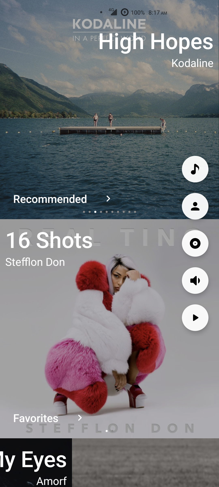
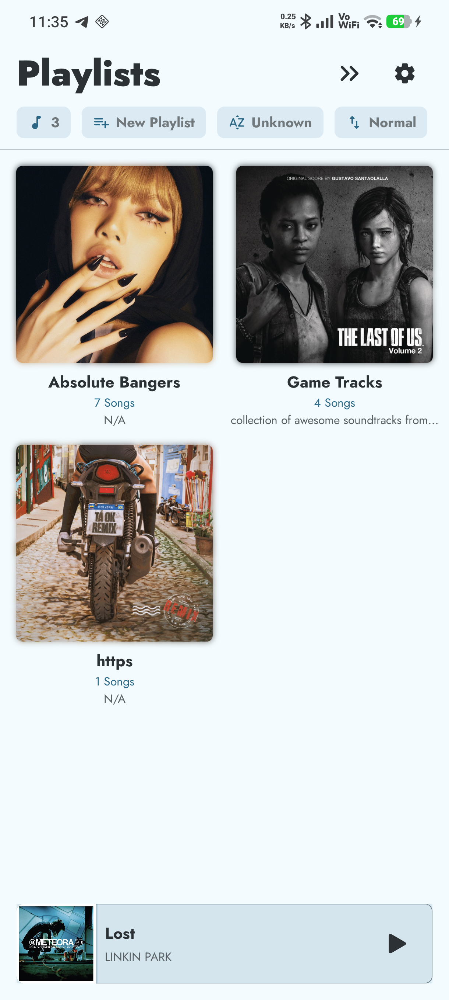
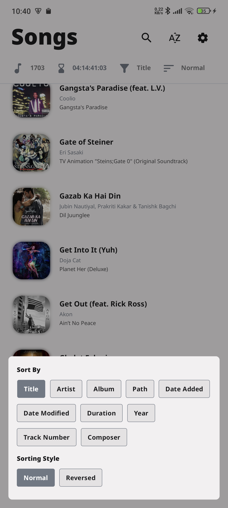
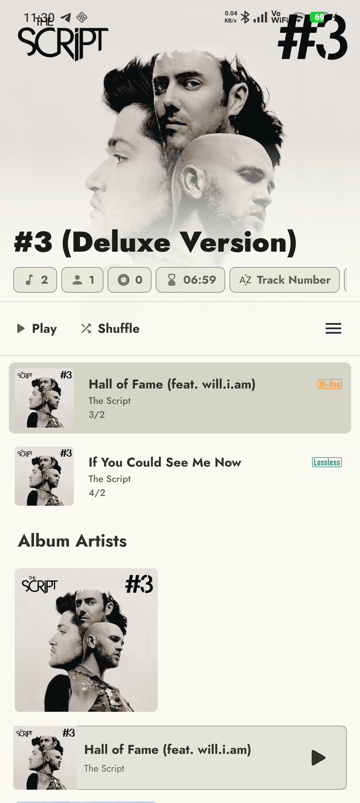
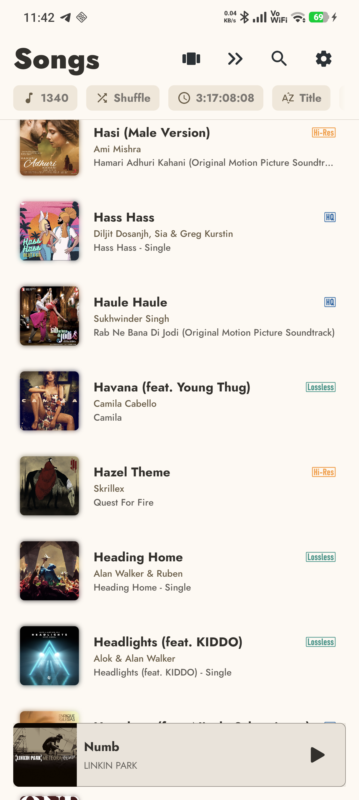
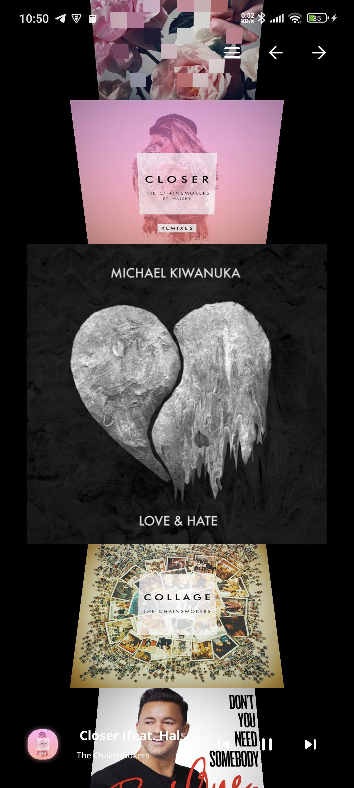
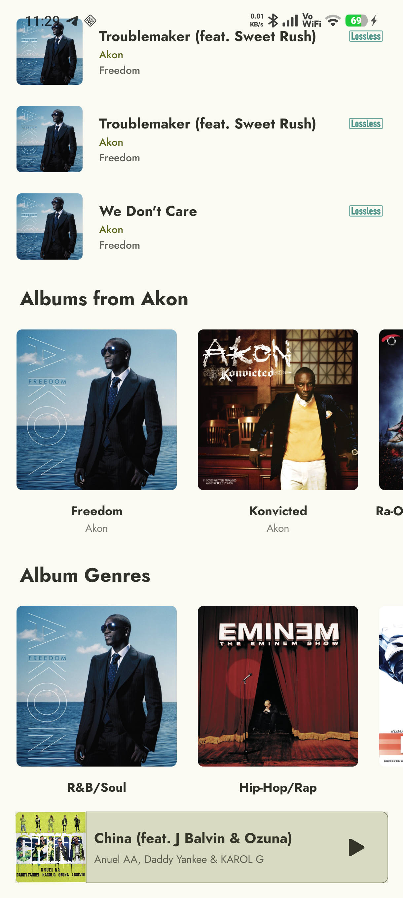
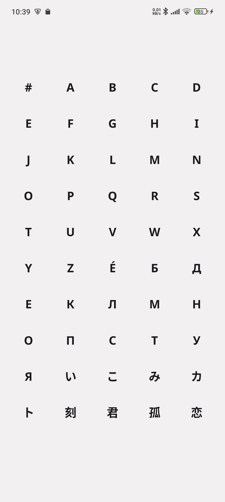
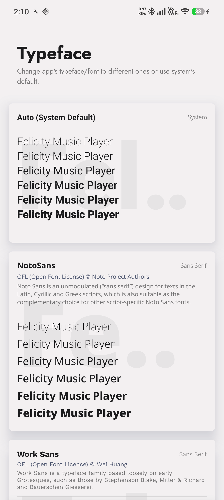

<div align="center">


# Soul

**A powerful, modern, and completely free audio player for Android.**

Created with ❤️ by **[Eloxxn](https://github.com/eloxn)**

<p align="center">
  <a href="https://github.com/eloxn/soul/releases/latest/download/Soul-v2.0.0.apk">
    
  </a>
</p>

[](./LICENSE)
[](https://www.android.com/)
[](https://github.com/eloxn/soul)
[](https://github.com/eloxn/soul/releases/latest)

</div>

---

## 📥 Direct Download

You can download the latest signed release APK directly using the link below:

👉 **[Download Soul v2.0.0 APK](https://github.com/eloxn/soul/releases/download/v2.0.0/Soul-v2.0.0.apk)** *(Signed with Scheme v2/v3)*

All release notes and assets are also available on the **[Releases Page](https://github.com/eloxn/soul/releases)**.

---

## 🎵 About Soul

**Soul** is a high-performance, fully unlocked, audiophile-grade music player designed from the ground up for Android. Built with a passion for pristine acoustics and modern fluid design, Soul combines a custom low-latency C++ DSP audio engine with dynamic theming to bring your music to life.

Soul is **100% free and open-source** — no subscriptions, no ads, no paywalls, and no feature gates.

---

## ✨ Features

### 🎧 Custom C++ Audio Engine & DSP
- **Dual Decoder:** Seamless combination of hardware decoding and software decoding through FFmpeg.
- **Audiophile High-Res Support:** Native playback for FLAC, ALAC, DSD, WAV, MP3, AAC, and multi-channel audio (5.1 and 7.1).
- **10-Band Equalizer & AutoEQ:** Precision 10-band EQ with +/-15 dB adjustment, PreAmp control, and automatic AutoEQ profile loading for thousands of headphones.
- **ReplayGain & EBU R128:** Track and album gain normalization preventing abrupt loudness jumps across albums and playlists.
- **Hardware Acceleration:** Native DSP audio processing utilizes ARM NEON SIMD auto-vectorization for near-zero CPU overhead and battery conservation.
- **Advanced Sound Effects:** Built-in Bass Boost, Treble adjustment, Reverb, Stereo Widening, and Tape Saturation for an authentic analog warmth.
- **Gapless & Smart Crossfade:** Uninterrupted transitions between tracks with customizable crossfade easing curves (0–12s).
- **3D & Canvas Visualizers:**
  - Custom GLSL Shader Sandbox with real-time fragment compiler and audio-reactive uniforms.
  - Gyroscope Parallax, Orbit turntable mode, and Beat-Cam transient response.
  - Intelligent 3D Battery Saver capping frame rates and scaling resolution dynamically.
  - Real-time Milkdrop visualizer and ultra-fast Canvas spectrum powered by PFFFT.

### 🎨 Modern UI & Lyrics Ecosystem
- **Floating & Overlay Lyrics:** Draggable, translucent lyrics pill over any app and PiP (Picture-in-Picture) playback.
- **Dual-Language & Transliteration:** Secondary translation and Romaji/Pinyin tracks rendered synchronously.
- **Lyrics Card Generator:** Highlight stanzas with blurred album art or 3D scene backdrops and export custom graphics for social sharing.
- **Tap-to-Sync Offline Editor:** Record real-time lyric timestamps on the fly and export standard `.lrc` or LRCLIB YAML files.
- **Live Synced Lyrics Widget:** Interactive home screen widget showing active synchronized lyrics with media controls.
- **Album Art Theming & Monet:** Full support for Android 12+ Monet dynamic palettes alongside AMOLED Dark, Slate, Oil, and Light themes.
- **Edge-to-Edge Experience:** Native predictive back animations, gesture navigation, and edge-to-edge layouts.

### 🚗 Modern OS Integrations
- **Android Auto:** Full MediaLibraryService browse tree for car infotainment displays with driving-safe controls.
- **Scrobbling Support:** Broadcasts standard playback intents for Last.fm, Pano Scrobbler, and Simple Scrobbler.
- **Lock Screen & AOD:** Low-overhead live lyrics preview on Always-on-Display and lock screen.

### 📂 Smart Library Management
- **Instant Auto-Scan:** Automatically recognizes additions and deletions in your media storage in real-time.
- **Playlists & Queues:** Robust M3U playlist support, multiple queue management, tag editing, and bookmarks.
- **True Randomized Shuffle:** Choose between Miller and Fisher-Yates shuffle algorithms.
- **Local Server Mode:** Host a lightweight local web server directly from your phone to stream music to other devices on your Wi-Fi network.

---

## 📸 Screenshots

| Player & Lyrics | Equalizer & DSP | Library |
| :---: | :---: | :---: |
|  |  |  |
|  |  |  |
|  |  |  |

---

## 🛠️ Building from Source

### Prerequisites
- Android Studio / Android SDK (API 34+)
- Android NDK & CMake
- JDK 17 or JDK 21

### Build Instructions
Clone the repository:
```bash
git clone https://github.com/eloxn/soul.git
cd soul
```

Compile the release APK:
```bash
# Build the FOSS release APK
./gradlew :music:assembleFossRelease

# Or build the standard release APK
./gradlew :music:assemblePlayRelease
```

The compiled APK will be located in:
`music/build/outputs/apk/foss/release/music-foss-release.apk`

---

## 👤 Creator

Soul is created and maintained by **[Eloxxn](https://github.com/eloxn)**.

If you enjoy using Soul or want to contribute, feel free to star the repository or submit issues on GitHub!

---

## 📄 License

Soul is distributed under the [GNU AGPL v3 License](./LICENSE).
